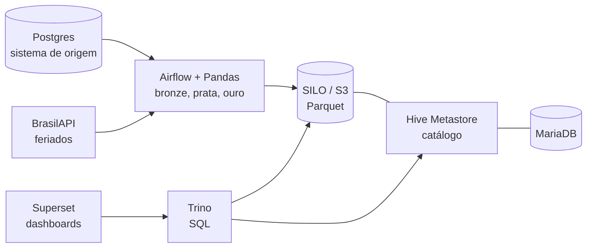
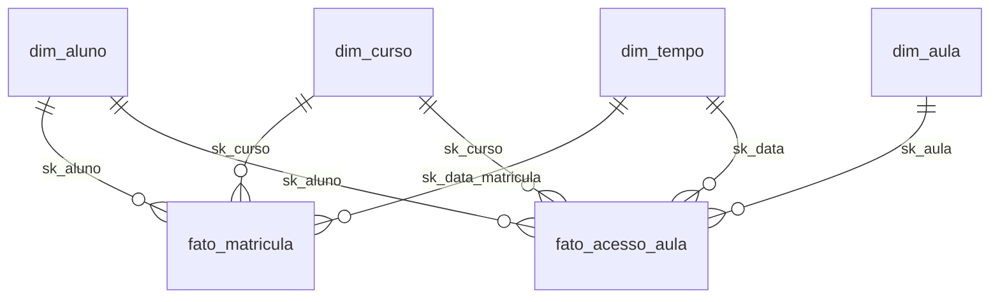
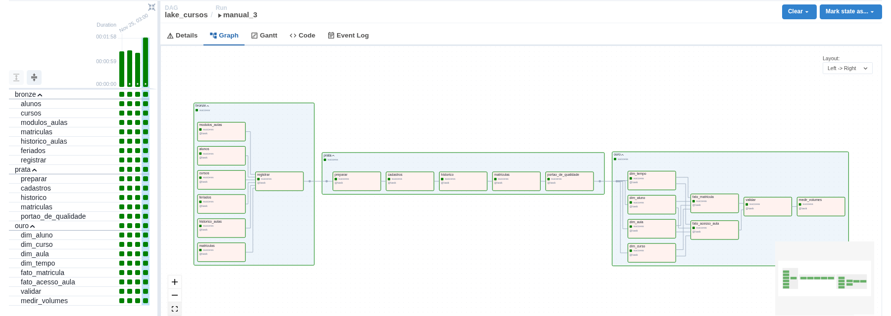
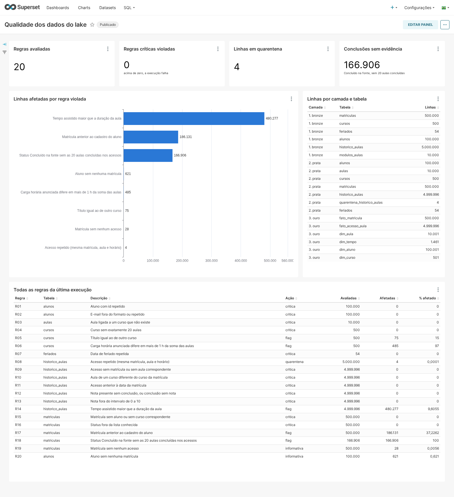
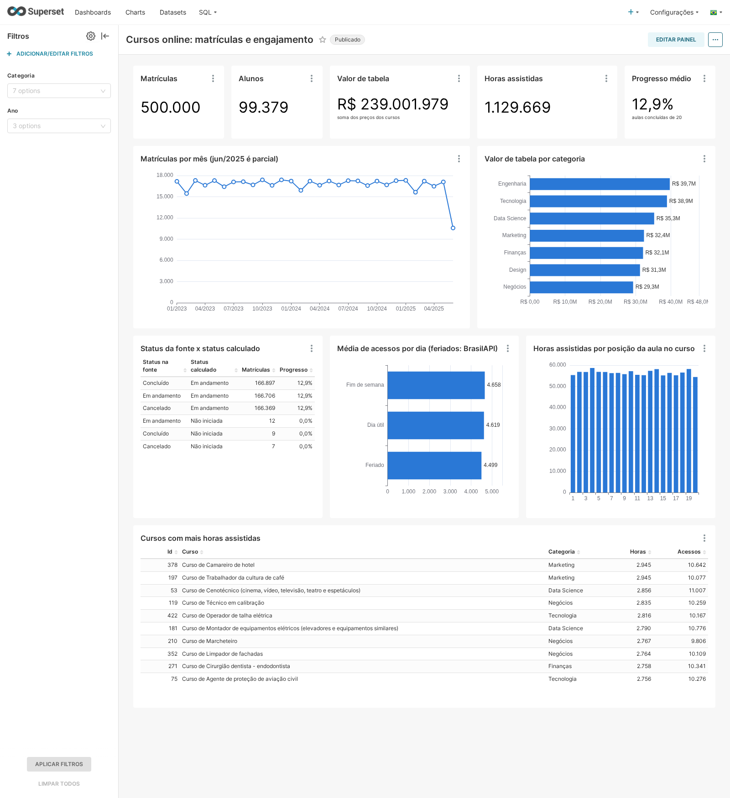

# Data lake de cursos online

Data lake com arquitetura medalhão (bronze, prata e ouro) sobre os dados de uma plataforma de cursos online: 5,6 milhões de linhas vindas de um Postgres, integradas a uma API pública de feriados, modeladas em esquema dimensional e servidas em dashboards.

Projeto final da disciplina de Tópicos em Banco de Dados, UFAL Arapiraca.

## Arquitetura



| Camada | O que contém | Como é gravada |
|---|---|---|
| **Bronze** | cópia fiel das 6 tabelas de origem, com metadados de ingestão | partição por dia; reexecutar substitui só o dia |
| **Prata** | dados limpos e tipados, 20 regras de qualidade, quarentena e progresso recalculado | substituída a cada execução |
| **Ouro** | 4 dimensões e 2 fatos | substituída a cada execução; acessos particionados por ano |

O armazenamento é o [SILO](https://github.com/pgsty/silo), fork comunitário do MinIO, porque as imagens oficiais do MinIO não estão mais acessíveis no Docker Hub.

## Modelo dimensional



- **`fato_acesso_aula`**: uma linha por acesso de uma matrícula a uma aula (4.999.996 linhas).
- **`fato_matricula`**: uma linha por matrícula, com o progresso acumulado (500.000 linhas).
- As dimensões compartilhadas têm chave substituta própria e uma linha `-1` para "desconhecido".

## Como rodar

Requisitos: Docker com Compose, cerca de 6 GB de RAM livres e 10 GB de disco.

1. Coloque os 5 CSVs em `data/`: `alunos.csv`, `cursos.csv`, `modulos_aulas.csv`, `matriculas.csv` e `historico_aulas.csv`. Eles não vão para o git, porque o histórico tem 261 MB.
2. Crie o `.env` e troque as senhas:

   ```bash
   cp .env.example .env
   ```

3. Suba tudo. Na primeira vez, a carga do Postgres leva cerca de 30 segundos:

   ```bash
   docker compose up -d --build --wait --wait-timeout 600
   ```

4. Ative e execute o pipeline:

   ```bash
   docker compose exec airflow airflow dags unpause lake_cursos
   ```

   Ao ser ativada, a DAG agendada executa uma vez. Para executar de novo, use **Trigger DAG** na interface.

5. Com a execução verde, crie os dashboards:

   ```bash
   docker compose exec superset python /app/projeto/criar_dashboards.py
   ```

| Serviço | Endereço | Usuário |
|---|---|---|
| Airflow | http://localhost:8082 | `admin` |
| Superset | http://localhost:8088 | `admin` |
| SILO (console) | http://localhost:9001 | `S3_USER` |
| Trino | http://localhost:8080 | qualquer nome |
| Postgres de origem | `localhost:5433` | `PG_USER` |

As senhas estão no `.env`. O arquivo [sql/consultas_negocio.sql](sql/consultas_negocio.sql) tem 7 perguntas de negócio respondidas no Trino.

## Pipeline



Uma execução completa leva entre 1,5 e 2 minutos. Há dois portões que interrompem o pipeline:

1. **Qualidade (prata):** falha se alguma regra crítica for violada.
2. **Validação (ouro):** 27 testes em [sql/validacao_ouro.sql](sql/validacao_ouro.sql), como contagens, chaves órfãs e totais comparados com a prata e com o Postgres.

## Qualidade dos dados

Os problemas da fonte são medidos e marcados, não "corrigidos". Nada é descartado em silêncio.

| Achado | Linhas | Tratamento |
|---|---|---|
| Tempo assistido maior que a duração da aula | 480.277 (9,6%) | flag; percentual limitado a 100% e valor original preservado |
| Matrícula anterior ao cadastro do aluno | 186.131 (37,2%) | flag; removê-las levaria junto os acessos ligados a elas |
| Status "Concluído" sem as 20 aulas concluídas | 166.906 (100% dos concluídos) | flag e status recalculado pelos acessos |
| Aluno sem nenhuma matrícula | 621 | contado |
| Carga horária anunciada diferente da soma das aulas | 485 de 500 cursos | flag e carga real calculada |
| Título igual ao de outro curso | 75 cursos | flag; a chave é o `curso_id` |
| Matrícula sem nenhum acesso | 28 | contado |
| Acesso repetido | 4 | quarentena, com o motivo |



## Dashboard de negócio



## Decisões técnicas

- **Leitura em chunks:** os 5 milhões de acessos são lidos com cursor no servidor, 250 mil por vez.
- **Catálogo por SQL:** as tabelas externas são recriadas pelo Trino a cada execução, a partir do schema do Parquet. Uma mudança de coluna vale já na execução seguinte.
- **Idempotência:** rodar duas vezes no mesmo dia produz o mesmo resultado.
- **Healthcheck com `-h 127.0.0.1`:** durante o init, o Postgres aceita conexões só no socket local. Sem o `-h`, o serviço pareceria pronto antes do fim da carga.
- **Horas em `double`:** no Trino, `segundos / 3600.0` é decimal e arredonda cada linha antes da soma, o que tirava quase 6 mil horas do total.
- **Dados pessoais:** o e-mail não sai da prata, porque nenhuma análise precisa dele.

## Limitações

- Os dados são sintéticos e quase uniformes. Diferenças pequenas entre categorias, dias ou aulas não devem ser lidas como padrão de comportamento.
- "Valor de tabela" soma o preço dos cursos matriculados. A fonte não informa o valor pago.
- A carga é completa a cada dia, sem ingestão incremental.
- A imagem do Hive Metastore é de 2020 e foi fixada pelo digest. Em produção, caberia uma alternativa mantida.
